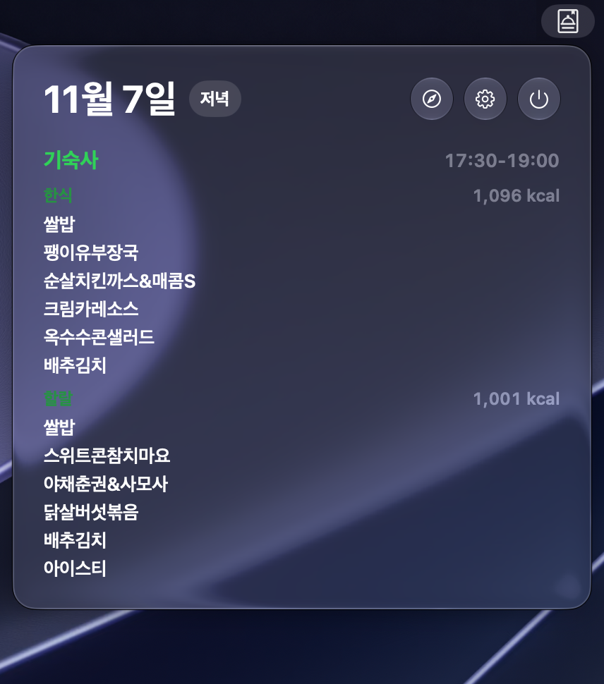
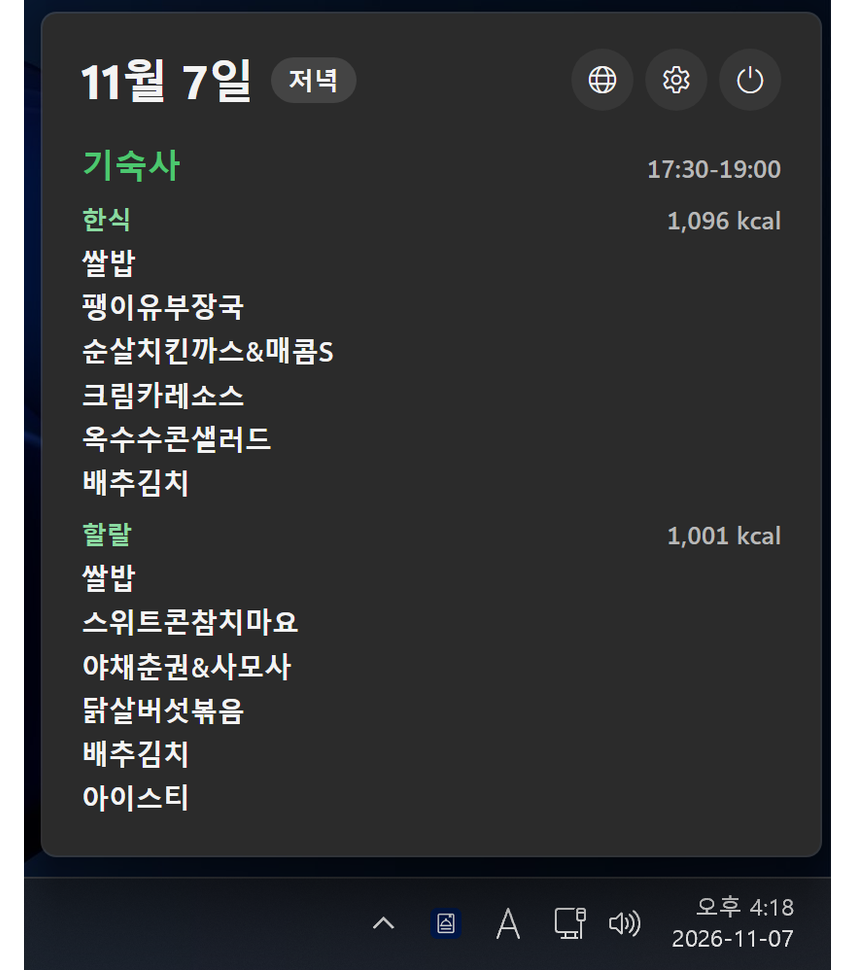

# Babbar

식단표 정보를 macOS 메뉴바와 Windows 작업 표시줄에서 바로 확인하는 위젯입니다.

## 화면

<table>
  <tr>
    <th width="50%">macOS</th>
    <th width="50%">Windows</th>
  </tr>
  <tr>
    <td valign="top"></td>
    <td valign="top"></td>
  </tr>
</table>

## 요구 사항

- macOS 26 이상, Apple Silicon
- Windows 10 또는 11 (x64)

## 설치

### macOS

- [Releases](https://github.com/beaulowo/Babbar/releases/latest)에서 dmg 파일을 받은 뒤 `Babbar.app`을 `Applications`로 드래그.
- "‘Babbar.app’을(를) 열지 않음" 팝업이 나타나면 설정 - 개인정보 및 보안 - 그래도 열기 클릭

### Windows

## 사용

### macOS

- 메뉴바의 Babbar 아이콘을 누르면 현재 시각 기준 식단표가 표시됩니다.
- 식사 시간이 지나면 다음 식단표로 자동 전환됩니다.
- 설정 버튼에서 로그인 시 자동 실행을 켤 수 있습니다.
- 설정 버튼에서 업데이트를 확인할 수 있습니다.

### Windows

- 작업 표시줄 오른쪽의 Babbar 아이콘을 누르면 현재 시각 기준 식단표가 표시됩니다. 아이콘이 보이지 않으면 `^`를 눌러 숨겨진 아이콘에서 찾을 수 있습니다.
- 식사 시간이 지나면 다음 식단표로 자동 전환됩니다.
- 설정 버튼에서 Windows 시작 시 자동 실행을 켤 수 있습니다.
- exe로 설치했다면 설정 버튼에서 업데이트 확인과 업데이트 자동 설치를 사용할 수 있습니다.

## 라이선스

GPL-2.0
